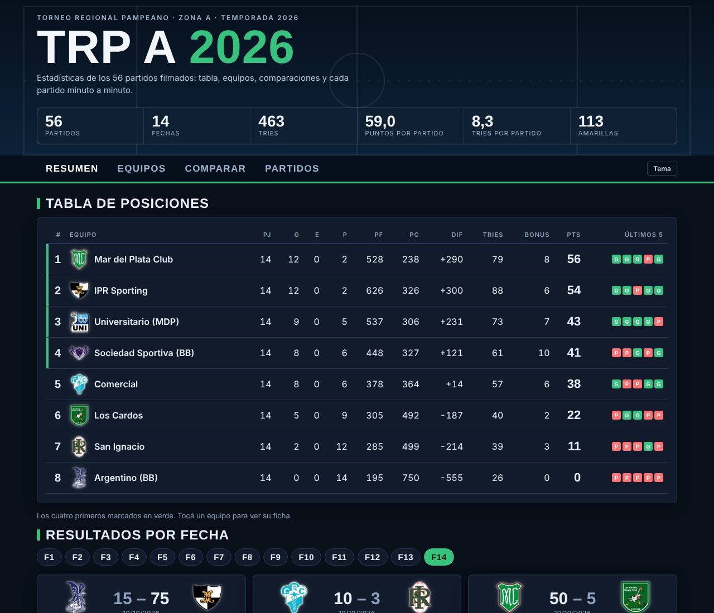
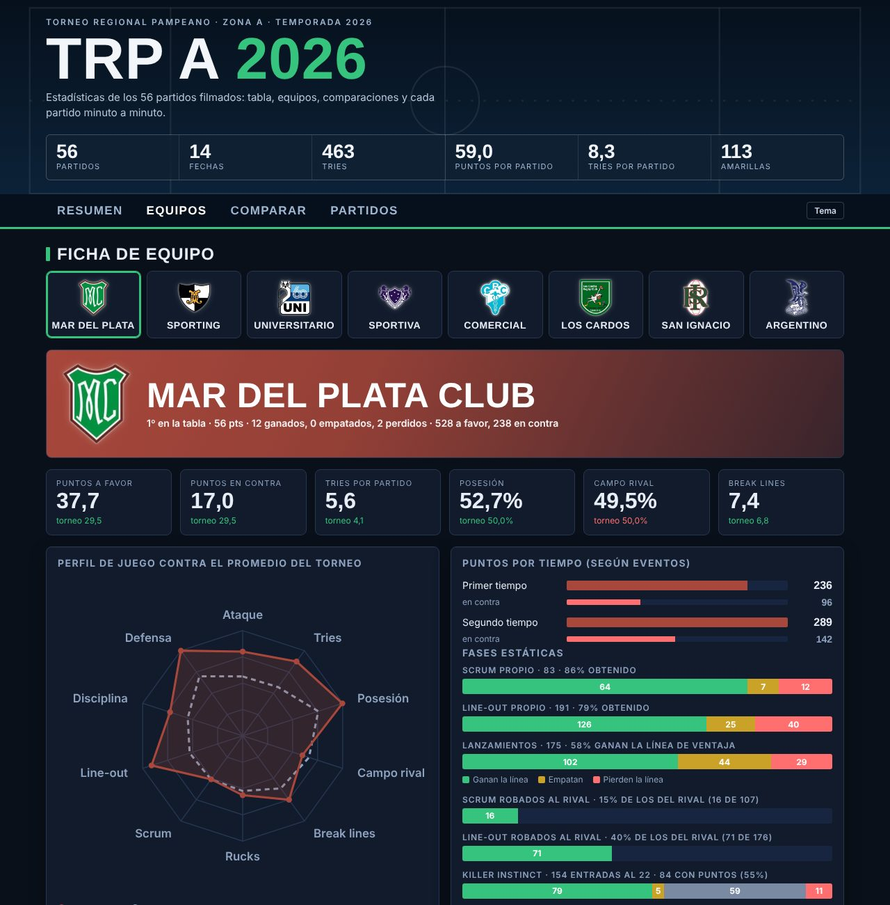
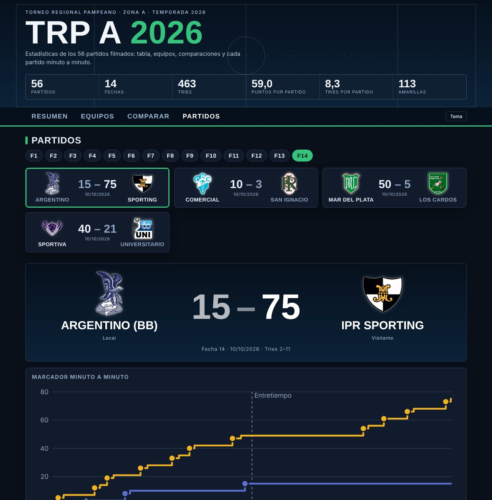

# 🏉 TRP-A 2026 Analytics

**Interactive rugby stats centre for the TRP A 2026 tournament** — standings, results, and team / match statistics built from frame-by-frame video analysis.

### 👉 [Open the live dashboard](https://santiagobalbarrey.github.io/TRP-A-2026-analytics/)



## What you can do
- **Spanish / English:** a button in the menu switches the whole page between languages.
- **Overview:** league table, tournament leaders and key numbers.
- **Teams:** a profile per club with radar chart, possession and territory, set pieces, discipline and where tries come from.
- **Compare:** any two teams head to head, stat by stat.
- **Matches:** every round, minute-by-minute scoreboard, possession and territory every 5 minutes, and a full stat sheet per match.

| Team profile | Match centre |
|---|---|
|  |  |

## What's measured
56 matches · 8 teams · 14 rounds · ~37,900 tagged events.

Some of the less common stats:
- **Killer instinct:** 22-metre entries and the % that end in points.
- **Scrums and line-outs won and stolen** (the rival's ball taken), with percentages.
- **Break lines:** how they end and what follows (pass, ruck, try).
- **Launch plays:** how many win or lose the advantage line.
- **Ball in play (BIP)** and out-of-play time, possession and territory per 5-minute block.

## Open data
CSV files in [`data/2026/`](data/2026):

| File | Content |
|---|---|
| `eventos.csv` | Every tagged event, with team, half, minute and outcome |
| `partidos.csv` | Result and details per match |
| `stats_equipo_partido.csv` | One row per team and match |
| `tabla_posiciones.csv` | Standings |

## How it's built
Matches are tagged in LongoMatch. A Python pipeline turns the `.lgm` files into the CSVs and the page:

| Step | Script | What it does |
|---|---|---|
| 1 | `src/parse_lgm.py` | Reads the `.lgm` files (JSON) and their events |
| 2 | `src/detect_halves.py` | Optional helper: suggests where each half starts, to review in `config/tiempos_2026.xlsx` |
| 3 | `src/build_events.py` | Normalises event names and tags, assigns each event to its half |
| 4 | `src/rescale.py` | Rescales each half to 40 min of real play, keeping ball-in-play time intact |
| 5 | `src/stats.py` | Team stats per match and standings (4/2/0 + bonus points) |
| 6 | `src/export_csv.py` | Writes the 4 CSVs to `data/2026/` |
| 7 | `src/build_site.py` | Builds `docs/index.html` (static page, vanilla JavaScript and SVG charts, Spanish and English) |

Season-specific settings (name fixes, manual score corrections, official points, incomplete matches) live in `config/2026.json`.

### Run it
```bash
pip install -r requirements.txt
# put the .lgm files in input/lgm/  (or set TRPA_LGM_DIR)
python src/run_all.py
```
The `.lgm` files and videos are not part of this repository.

## Structure
```
config/   season settings and the reviewed half-start times
src/      pipeline scripts
site/     page templates and club crests
data/     CSV per season
docs/     published page (GitHub Pages)
assets/   screenshots for this README
```

## Data notes
- Times are normalised to 80 minutes; out-of-play time = 80 min minus BIP.
- Standings use the official points.
- In 3 matches the tagged events don't add up to the official score; the page shows the official result with a note.
- Round 1, Comercial vs Argentino, has an incomplete second-half video.

Club crests belong to their clubs and are used only to identify the teams.

---

## 🇦🇷 En español
Centro de estadísticas del TRP A 2026: tabla de posiciones, resultados y estadísticas por equipo y por partido, a partir del análisis de video. Los datos están en `data/2026/` y la página en vivo está en el link de arriba.
